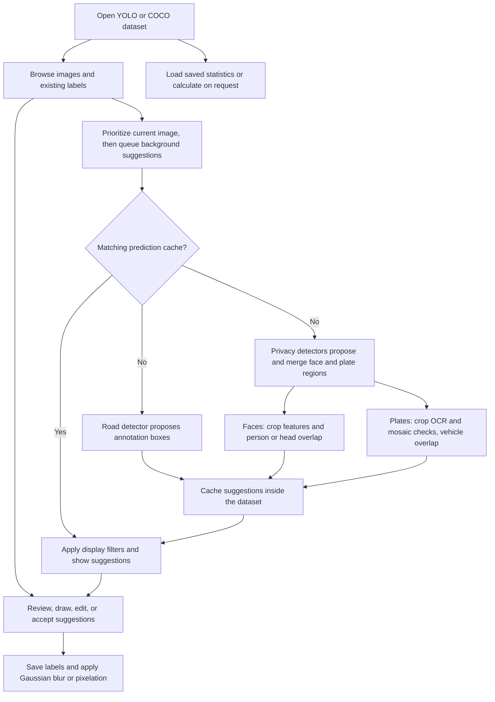

# Box & Blur

Object Detector Dataset Review Annotation Anonymization Tool

Box & Blur is a local browser editor for reviewing and correcting YOLO and
COCO object detection datasets. It includes box editing, Gaussian blur and pixelation,
optional model suggestions, background prediction caching, and downloadable
dataset statistics.

## Quick start

Install **64-bit Python 3.12** and clone this repository. The launcher creates
a virtual environment and installs the pinned detector runtime and the
packages in `requirements.txt` on first run. Later launches reuse it.

| Platform | Command from the repository folder |
| --- | --- |
| Windows PowerShell | `.\run.cmd` |
| Linux | `sh run.sh` |
| macOS on Apple Silicon | `sh run.sh` |

You can also run `python3.12 run.py` directly. On Debian or Ubuntu, install
Python's matching `venv` package if the environment cannot initialize. Native
Apple Silicon Python is required for the macOS dependency set. Intel macOS
is outside the supported dependency set.

The launcher tries CUDA on Windows or Linux when it detects an NVIDIA driver,
using PyTorch's CUDA 12.6 wheels, and falls back to CPU if CUDA setup fails.
macOS uses CPU. Use `--compute cpu` or `--compute cuda` to select explicitly.
The first installation needs internet access and substantially more disk space
than the model files, particularly for CUDA. [PyTorch builds](https://pytorch.org/get-started/previous-versions/#v271)

```sh
python3.12 run.py --setup-only
python3.12 run.py --compute cpu --dataset "/path/to/dataset"
python3.12 run.py --no-browser --port 8767
```

The launcher prints the local URL and opens it in your browser by default.
Keep the launcher running while you work. The server binds to loopback.
Use **Open dataset** to choose a folder. On Windows, Browse lists all drives
available to the signed-in account. On Linux and macOS, browse from `/` to a
mounted volume, such as `/mnt`, `/media`, or `/Volumes`. Reads and saves use
the account's normal filesystem permissions. This release uses a venv so you
can work directly across host drives without setting up container mounts.

## Optional model files

Manual editing, blur, and statistics work without checkpoints. To enable
model suggestions, supply the following local files. The privacy models use
about **147 MB**, plus about **19 MB** for the reference road checkpoint.
These sizes exclude Python packages and prediction caches.

| Default location | Model and original source | Approximate size |
| --- | --- | ---: |
| `models/road.pt` | A compatible local Ultralytics detector. The original setup used a privately held YOLO11s fine-tune. The [road project](https://github.com/eldux/road-irregularities-detection-characterization-tracking) documents a local checkpoint path. | 19 MB |
| `models/privacy/dashcam.pt` | [Dashcam YOLOv8 checkpoint referenced by the fork](https://raw.githubusercontent.com/eldux/dashcam_anonymizer/master/setup.sh) | 88 MB |
| `models/privacy/yunet.onnx` | [OpenCV Zoo YuNet 2023mar](https://huggingface.co/opencv/opencv_zoo/blob/main/models/face_detection_yunet/face_detection_yunet_2023mar.onnx) | 0.23 MB |
| `models/privacy/face_ssd.prototxt` and `face_ssd.caffemodel` | [OpenCV SSD network definition](https://github.com/opencv/opencv/blob/4.x/samples/dnn/face_detector/deploy.prototxt) and [ResNet-10 weights](https://github.com/opencv/opencv_3rdparty/blob/dnn_samples_face_detector_20170830/res10_300x300_ssd_iter_140000.caffemodel) | 11 MB |
| `models/privacy/plates.onnx` and `plates_s.onnx` | [Open Image Models YOLOv9 Tiny 640 and Small 608 ONNX assets](https://github.com/ankandrew/open-image-models/releases/tag/assets) | 36 MB |

| `models/privacy/context.pt` | [Ultralytics YOLO11n COCO checkpoint](https://github.com/ultralytics/assets/releases/tag/v8.3.0), downloaded as `yolo11n.pt`. Finds people and vehicles. | 5.6 MB |
| `models/privacy/heads.pt` | [YOLOv8n head detector](https://huggingface.co/Xulee-0806/YOLO-head-detection), downloaded as `v8n-head.pt`. | 6.2 MB |

To reuse existing copies, run with `--model-dir "/path/to/privacy_models"`
and `--road-weights "/path/to/best.pt"`. You can persist those two paths in an
ignored `.box_and_blur_local.json` file with keys `model_dir` and `road_weights`.
Only load checkpoints from sources you trust. Use the original publisher's
download and license terms for each file. Public download links can change.

## Reviewing a dataset

- Open a YOLO or COCO dataset and use the image library and filters to navigate.
- Draw boxes with **B**, draw blur regions with **G**, and move or resize them
  with **V**. Under **Privacy regions**, select **Gaussian blur** or **Pixelate**.
  Adjust Gaussian strength or pixel block size, then preview before saving.
  You can select an existing region to change its effect. **Ctrl+Z** undoes
  the last edit.
- Enable automatic suggestions in the inspector if the required weights are
  available. Accept a suggestion with its checkmark. **Shift+G** accepts all
  visible blur suggestions as one undo step.
- **Ctrl+S** saves edits. **Enter** saves, marks the image reviewed, and advances.
- **Dataset statistics** opens the saved report or lets you calculate it on demand.

The app writes label and image edits only when saved. It creates backups under
`.label_review/`. Background suggestions are saved separately in
`prediction_cache/` inside the selected dataset. The detailed shortcuts,
supported layouts, and statistics fields are in [the user guide](LABEL_REVIEW.txt).

## Pipeline overview



- **Road annotations.** The selected checkpoint proposes boxes. The reviewer can
  choose classes and confidence and hide suggestions that cover more than 70%
  of an existing annotation. Accepting a suggestion creates an editable box.
- **Privacy proposals.** Dashcam YOLOv8, YuNet and OpenCV SSD vote on faces.
  Dashcam YOLOv8 and the two YOLOv9 plate models vote on plates. Overlapping
  detections of the same type merge into a padded region with model votes.
- **Face verification.** YuNet landmarks and the OpenCV profile cascade check
  the proposed crop in both directions. A separate image-level pass finds
  people and another finds heads. By default the editor hides faces if the
  feature check fails or neither a person nor a head supports the region.
  Turn off the face filter to inspect those candidates.
- **Plate verification.** Mosaic checks and OCR use only proposed plate crops.
  OCR records whether characters were found and discards the text. The editor
  can hide already pixelated or unreadable candidates. If no detected car,
  truck, bus or motorcycle supports a plate region, its score is multiplied by
  0.65 and it appears in the weaker color when visible.
- **Review and persistence.** Enable **background preannotation and anonymization detection**
  to run the enabled detectors on upcoming images. The image in view gets
  priority, and the app reuses matching cached results. Cached suggestions are separate from
  saved labels and image edits. Reviewers can accept, adjust, or dismiss
  suggestions before saving. Statistics are calculated on request and saved in
  the dataset for later viewing.

## License

The application source is licensed under the [GNU Affero General Public License
v3.0](LICENSE). Dependencies, model weights, and datasets have separate terms.
The repository excludes local model files, datasets, caches, and environments.
See the [third-party licensing audit](BOX_AND_BLUR_LICENSE_AUDIT.md) for sources
and model redistribution status.
